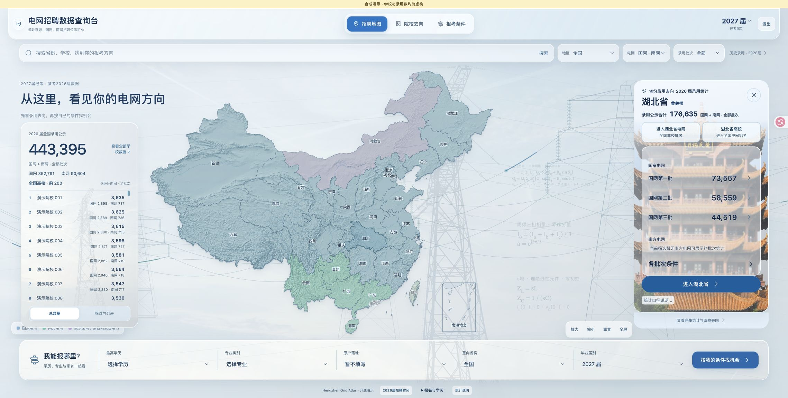
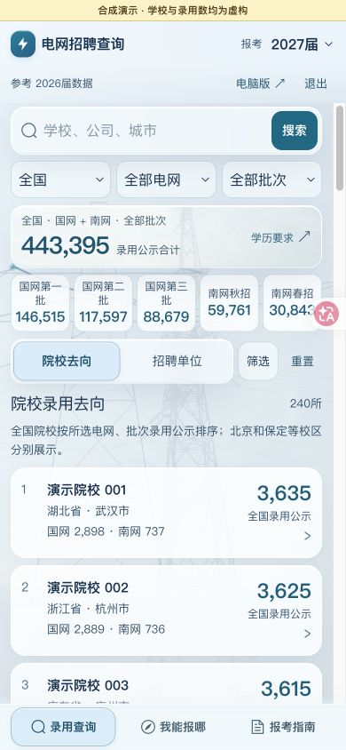

# Hengzhen Grid Atlas

**Explore electricity-sector recruitment through geography, universities, hiring rounds, and eligibility requirements.**

A recruitment visualization project for students, educators, and developers. It combines a desktop map, a mobile query interface, and a separate administration application for State Grid and China Southern Power Grid recruitment information.

[简体中文](README.md) · [Hosted product](https://ai-education.cn/) · [Quick start](#quick-start) · [Architecture](docs/architecture.md) · [Data model](docs/data-model.md) · [Changelog](CHANGELOG.md)

> This is an independent project maintained by Hengzhen Education. It is not affiliated with or endorsed by either grid company. This repository contains application source and clearly labeled synthetic demo data. Production datasets, user accounts, and hosted-service permissions are not included.

## Interface preview

These screenshots show the local synthetic demo; schools and hiring counts are fictional.



<details>
<summary>Mobile · 手机查询</summary>



</details>

## Features

- **Interactive recruitment maps:** national and provincial views with grid and hiring-round filters.
- **University outcomes:** a scrollable national Top 200, a complete school table, campus-level details, and separate State Grid / Southern Grid totals.
- **Two directions of provincial rankings:** schools nationwide hired into a province, or schools located in that province hired nationwide.
- **Eligibility reference matching:** compare education, major, and university attributes while keeping uncertain and ineligible results distinct.
- **Mobile-first lookup:** search, outcome details, reference matching, and an application guide with progressive disclosure.
- **Separate administration:** source records, reviewable data, explicit cohort and round boundaries, and authenticated APIs.

Where supported by sourced records, schools can show institution types, historical affiliations, and electrical-engineering admission scores. Scores are scoped by admission province, year, subject stream, program, and metric.

## Two provincial rankings, two different questions

| View | Question | School scope | Hiring destination |
|---|---|---|---|
| Nationwide universities → Hubei grid employers | Which universities supplied graduates to Hubei? | Nationwide | Hubei |
| Hubei universities → nationwide grid employers | Where do graduates of Hubei universities enter the grid sector? | Campuses in Hubei | Nationwide |

School location and hiring destination are independent dimensions. Campuses are identified separately; unknown campus locations are not assigned by guesswork. Both views retain grid and hiring-round breakdowns.

## Quick start

Use **Node.js 24.x** and npm. The demo runs in memory and does not require PostgreSQL.

```bash
git clone https://github.com/liao69040-collab/hengzhen-grid-atlas.git
cd hengzhen-grid-atlas
npm ci
npm ci --prefix platform/api
npm ci --prefix admin-app
npm run demo
```

| Application | Local URL |
|---|---|
| Desktop map | http://127.0.0.1:8112/#/index?view=desktop |
| Mobile query | http://127.0.0.1:8112/#/mobile |
| Administration | http://127.0.0.1:4174/ |

**Local synthetic demo credentials only; these do not grant access to the hosted product:**

| Role | Account | Password |
|---|---|---|
| Demo member | `13800138000` | `GridAtlasDemo123!` |
| Demo administrator | `demo-admin` | `GridAtlasDemo123!` |

The demo provides 240 fictional schools across three provinces and five hiring rounds. It demonstrates the map, Top 200, provincial ranking directions, and school breakdowns. Data and accounts reset on restart. The process binds to localhost and refuses production mode. Real admission scores, complete provincial eligibility rules, and recruitment source documents are not bundled; those features require authorized, sourced data. Fictional schools and counts are not recruitment guidance. See [demo/README.md](demo/README.md).

## Structure

```text
src/                    Vue 3 + TypeScript desktop and mobile UI
admin-app/              Separate Vue administration application
platform/api/           Fastify API, Drizzle persistence, and migrations
demo/                   Synthetic fixtures and local API entry point
public/                 Public frontend assets
scripts/                Demo launch and validation tools
deploy/example/         Generic deployment examples
docs/                   Architecture, data boundaries, and versioning
```

The frontend uses Vue 3, Vite, TypeScript, and ECharts. The API uses Fastify, Zod, and Drizzle ORM, with PostgreSQL for persistent deployments. Each application can be built separately. See [architecture](docs/architecture.md).

## Development checks

```bash
npm run test:demo
npm run type-check
npm run build
npm --prefix platform/api run typecheck
npm --prefix platform/api run build
npm --prefix admin-app run typecheck
npm --prefix admin-app run build
```

Consult each Release and CI run for validation of the published package. Earlier production checks do not prove a fresh checkout works in your environment. Real-device iPhone/WeChat gestures, sustained interaction performance, and device-specific layouts require separate testing.

## Data boundaries

Production databases, personal rosters, user accounts, sessions, access tokens, and restricted source documents are excluded. Self-hosting requires datasets you are authorized to use.

Application counts, planned positions, published hiring records, and actual employment are different metrics. Ratios require comparable cohorts, rounds, employers, and populations. Historical requirements do not automatically apply to a future recruitment cycle. Missing facts remain missing instead of being inferred as zero or eligibility.

Source attribution and content licenses remain separate from the software license. See [data model](docs/data-model.md) for the record structure and import expectations.

## Contributing and releases

Reproducible bug reports, accessibility and mobile improvements, data-model proposals, and sourced corrections are welcome. Read [CONTRIBUTING.md](CONTRIBUTING.md) before selecting an Issue template or opening a Pull Request. Follow [SECURITY.md](SECURITY.md) for vulnerabilities. Never include personal information, passwords, database exports, or private operational material in public reports.

Versioned tags and Releases preserve deliverables; branches and commits preserve day-to-day work. Changes are tracked in [CHANGELOG.md](CHANGELOG.md). See [versioning](docs/versioning.md).

## License and acknowledgements

This project builds on [daidaibg/IofTV-Screen-Vue3](https://github.com/daidaibg/IofTV-Screen-Vue3), retaining **daidai**'s copyright notice and the [MIT License](LICENSE). Thanks to Vue, Vite, ECharts, Fastify, Drizzle ORM, PostgreSQL, and the dependency maintainers.

Third-party imagery, geographic data, trademarks, and separately attributed materials follow their own terms. Inclusion of the Hengzhen Education name or branding does not imply endorsement of derivative products.
