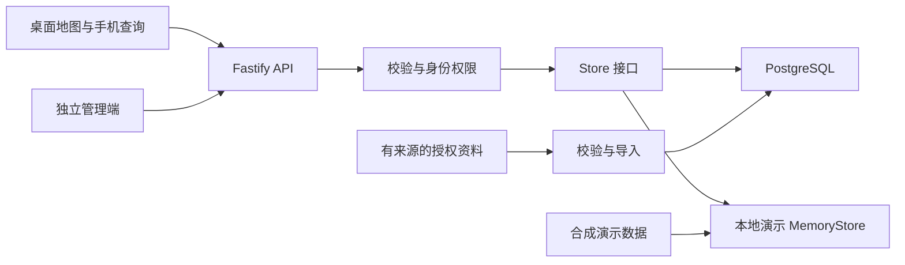

# 架构说明

Hengzhen Grid Atlas 将查询界面、管理界面和权限/API 分开。浏览器只接收当前身份可访问的数据；持久化存储与资料导入属于服务端职责。

## 前台与手机页面

`src/` 使用 Vue 3、TypeScript 和 Vite。ECharts 与地理资源负责地图呈现，查询页组合筛选、聚合摘要、排名和详情。手机页以搜索和逐级阅读为主，桌面页以地图与并列面板为主。

排名在两个维度间明确切换：招聘目的省，以及学校/校区所在地。前 200 名从服务端分页读取；列表和学校详情需要保持相同的地域范围。用户切省、切批次、切资料年份或退出登录时，旧请求不得覆盖新状态。

## API 与数据层

`platform/api/` 使用 Fastify 路由、Zod 输入校验和 Store 数据访问层。持久化实现采用 Drizzle ORM 与 PostgreSQL；本地演示使用 MemoryStore。服务端区分公开摘要、有效会员可读的数据和管理操作，前端隐藏按钮不能替代服务端权限校验。

数据库迁移描述结构变化，数据导入负责来源校验和业务记录。公开演示不会自动导入真实招聘资料；接入自有数据时应先在独立环境中完成字段、范围和汇总校验。

## 独立管理端

`admin-app/` 是独立构建的 Vue 应用。其认证、数据维护和来源查看通过管理 API 完成。前台用户会话与管理员会话不应混用；生产部署需要独立的管理员凭据和适当的权限范围。

## 演示与部署

`demo/` 包含虚构学校与聚合记录，`scripts/demo-run.mjs` 负责本机开发服务。演示不连接线上数据库，重启后不保留编辑结果。`deploy/example/` 提供通用部署示例；真实域名、证书、环境变量、数据库口令和备份策略由部署者配置。

构建前台不会自动部署 API 或完成数据库迁移。发布时应分别记录代码版本、数据版本和迁移状态，保留可恢复的前一版本；不要把应用回滚等同于数据库恢复。

前台可在构建时设置 `VITE_PROJECT_CONTACT` 作为维护者联系文字。不配置时不显示联系入口，登录提示引导阅读项目说明。该值会出现在公开页面与构建资源中，因此只填写可以向所有访客公开的联系方式。

## 验证分层

1. 类型检查与构建，确认三个应用可以生成产物。
2. 合成数据合同，核对计数、排名方向、分页与权限。
3. 浏览器路径，检查地图、筛选、学校详情和移动布局。
4. 部署检查，确认目标运行的是预期产物。
5. 真机与恢复演练，分别验证手势、性能和备份可恢复性。

每一层只证明其实际覆盖的范围；源码检查与单次健康响应不能替代完整业务验收。
